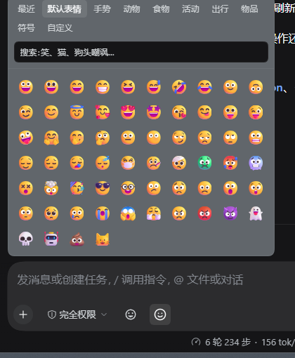

# 表情面板 · DSH emoji panel

在 DeepSeek Harness 的消息输入框左侧加一个表情按钮，点开是微信那种面板：Unicode emoji + 自己导入的表情包。



## 安装

```powershell
# 从 npm
dsh plugin --profile desktop add dsh-emoji-panel

# 或直接从仓库装
dsh plugin --profile desktop add git+https://github.com/BadWolfZXY/dsh-emoji-panel.git
```

装进市场后也可以在 **插件 → 发现** 里搜「表情面板」一键安装。

本地开发：`dsh plugin --profile desktop add "E:\Private Projects\AI\DSH\emoji-panel"`，改完刷新页面即可。

## 怎么开

1. 插件默认启用（**插件** 页能看到「表情面板」这一行）。
2. 任意会话的输入框左下角、附件按钮一带有一个 🙂 图标。
3. 点它 → 面板浮在输入框**上方**；点内容插入，**插完自动收起**；点面板外面或按 `Esc` 也能关。

插入之后**焦点和光标都回到输入框、落在刚插进去的表情后面**，所以可以立刻接着打字。实现上是两件事：表情按钮 `pointerdown` 里 `preventDefault()` 不让按钮抢焦点；插完再调宿主的 `inputActions.focus()`（Lexical 的 `insertText` 本身已经把选区落在插入内容之后）。

面板是**固定高度**（380px），不随内容多少上下跳，也不跟窗口高度走；内容超出在网格里滚动。窗口特别矮时最多让到 `100vh - 120px`，保证上面还有点击余地。

## 面板结构

```
[最近] [默认表情] [手势] [动物] [食物] [活动] [出行] [物品] [符号] [自定义]
[                搜索框（常驻）                 ]
[                内容网格（可滚动）              ]
```

- **分类标签**：切换分类；切分类会自动清空搜索词。
- **搜索框常驻**在分类下面，不再单独占一个标签页。输入关键词时**跨所有分类搜索**（emoji 的中英关键词 + 自定义表情的含义），清空后回到当前分类。
- **最近**：记录最近点过的 24 个 emoji，按使用顺序排，重复点会提到最前。
- **自定义**：导入自己的表情包图片。

## 导入自定义表情

切到「自定义」标签：

1. **从文件**：选一张本地图片（png/jpg/gif/webp 都行）。
2. **粘贴图片网址**：把网上的图片地址贴进输入框，回车或点「导入」。
3. 选好后会出现预览条，**必须写一句含义**（例：`狗头嘲讽`），点「保存」。

存进去之后：

- 网格里显示缩略图，**点一下插入 `[表情: 狗头嘲讽]`** 到光标处。
- 鼠标悬停在缩略图右上角会出现 `×`，点它删除。
- 图片会先压到 160px 边长再存，省空间；跨域图片拿不到像素时只存原始网址（挂不住的图会显示空白，删掉重来即可）。

### 为什么插入的是文字而不是图片

DSH 的输入框只能通过宿主的附件接口带图片，普通插件塞不进图片。更重要的是：**模型要理解这个表情，靠的是那句含义，不是像素。** 插入 `[表情: 狗头嘲讽]`，模型看到的就是这个意思，效果和发"狗头"两个字一样，但比手打省事。

想让模型**真的看到图**，用已装的 `dsh-meme`：它的面板支持附图，点图会把原图挂成附件（需要支持视觉的模型）。两个面板可以并存，各管一块。

## 怎么加自己的 emoji

数据在 `client.js` 的 `GROUP_DEFS`，每行格式：

```
'😀 笑 开心 咧嘴 grin smile happy'
```

第一个 token 是字符，后面全是搜索关键词（中英混排，大小写不敏感）。

- 往已有分类加：在对应 `items` 里加一行。
- 加新分类：加一项 `{ id: 'mine', items: [...] }`，再在 `ZH` / `EN` 字典里补 `'tab.mine': '我的'`。标签按 `tab.<id>` 取文案。

## 数据存在哪

只用浏览器 `localStorage`，不联网、不上传、不碰宿主文件：

| 键 | 内容 |
| --- | --- |
| `dsh-emoji-panel:recent` | 最近使用的 emoji 字符 |
| `dsh-emoji-panel:custom` | 自定义表情 `{ id, src, caption }`，src 是缩略图 dataURL 或原图网址 |

上限：最近 24 个、自定义 60 个。清浏览器数据会一起清掉；配额满了会提示「本地空间不足」。

## 文件

| 文件 | 作用 |
| --- | --- |
| `client.js` | 全部 UI：按钮、面板、分类、搜索、最近、导入、插入；emoji 数据也在这里 |
| `index.js` | Host 半边，空实现（只为了让 Loader 能插入这一行） |
| `cordis.patch.yml` | bundle patch，插入 `id: emoji-panel` 一行 |
| `locale/zh.json` / `locale/en.json` | 插件页显示用的标题与描述 |

## 已知限制

- 自定义表情只在**当前浏览器**可见，换浏览器/换机器不同步。
- 插入的是含义文字，不是图片本体（原因见上）。
- 没有 AI 自动识别图片内容：那需要 Host 半边调模型（`ctx.llm` + 视觉模型），本版没做。手动写一句含义成本更低、更准。
- 面板定位依赖宿主 composer card 作为定位容器（`absolute; bottom:100%`），不 portal 到 body。
- 样式只用 `--dsw-alias-*` 主题 token，明暗主题自适应。

## 许可

MIT。上架流程（npm 发布 → GitHub 仓库 → 社区索引 PR → 自建索引源）见 [PUBLISHING.md](PUBLISHING.md)。
